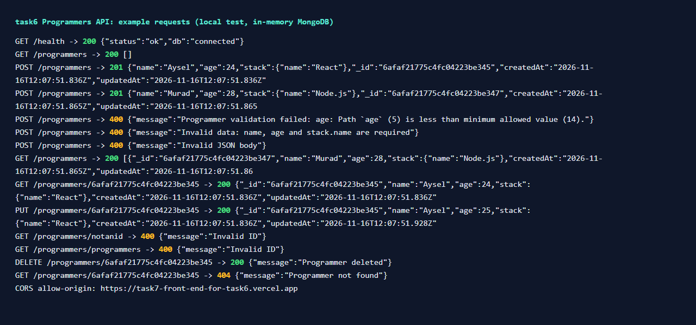

# Programmers API (Express + MongoDB)

> AZ: Proqramçılar siyahısı üçün Express + Mongoose REST API (task7 frontend-inin backend-i).

A small REST API that stores programmers (`name`, `age`, `stack`) in MongoDB. It is the backend for the
[Programmers directory frontend](https://github.com/codelady-ship/task7-front-end-for-task6-)
([live](https://task7-front-end-for-task6.vercel.app/)).

**Status:** the code is ready to deploy on Render (see below). Until it is deployed, the frontend runs in demo mode with sample data.



## Endpoints

| Method | Path | Body | Response |
|---|---|---|---|
| GET | `/health` | | `200 {status:"ok", db:"connected"}` or `503` when MongoDB is down |
| GET | `/programmers` | | array of programmers (newest first, `[]` when empty) |
| POST | `/programmers` | `{ "name": "Aysel", "age": 24, "stack": { "name": "React" } }` | `201` + the created programmer |
| GET | `/programmers/:id` | | one programmer, `404` if missing, `400` for a bad id |
| PUT | `/programmers/:id` | any of `name`, `age`, `stack` | `200` + the updated programmer |
| DELETE | `/programmers/:id` | | `200 {message}` |

Validation: `name` (1–60 chars), `age` (14–99), `stack.name` (1–40 chars) are required.

## Tech stack

Node.js 20+ · Express 5 · Mongoose 8 · MongoDB Atlas · CORS · Render (hosting)

## Run locally

```bash
git clone https://github.com/codelady-ship/task6.mongodb.git
cd task6.mongodb
npm install
cp .env.example .env      # then put your own MONGODB_URI in .env
npm run dev               # http://localhost:8080
```

```bash
curl http://localhost:8080/health
curl -X POST http://localhost:8080/programmers -H "Content-Type: application/json" \
  -d '{"name":"Aysel","age":24,"stack":{"name":"React"}}'
```

Environment variables (see `.env.example`):

- `MONGODB_URI` (required): MongoDB connection string. Never commit it.
- `CORS_ORIGINS` (optional): comma-separated allowed origins. Empty = all origins.
- `PORT` (optional): defaults to 8080; Render sets it automatically.

## Deploy on Render

1. In MongoDB Atlas, create a database user with a strong password and allow network access from `0.0.0.0/0`
   (Render's free plan has no fixed IP). Copy the connection string.
2. On Render: **New > Blueprint**, pick this repo. `render.yaml` creates the `task6-programmers-api` web service.
3. When Render asks for `MONGODB_URI`, paste the Atlas connection string.
4. After the deploy, open `https://<service>.onrender.com/health`; it should return `{"status":"ok","db":"connected"}`.
5. In the Vercel project of the frontend, set `PROGRAMMERS_API_URL=https://<service>.onrender.com/programmers` and redeploy.

The free plan sleeps after 15 minutes without traffic, so the first request can take about 30 seconds.

## Project structure

```
app.js                        Express app: CORS, JSON, /health, routes, error handler
Routes/programmers.js         CRUD routes, mounted at /programmers
Models/programmersModel.js    Mongoose model
Schemas/programmersSchema.js  Mongoose schema (exported, not a model)
render.yaml                   Render Blueprint
```

## What I learned

- Building a REST API with Express routers and Mongoose models.
- Mounting a router once: the router uses `/` and `/:id`, and `app.use("/programmers", router)` adds the prefix.
- Keeping secrets out of Git with environment variables and `.env.example`.
- Returning clear status codes (400 / 404 / 500) and validating input on the server.
- Enabling CORS so a frontend on another domain can call the API, and adding a health check for hosting.
